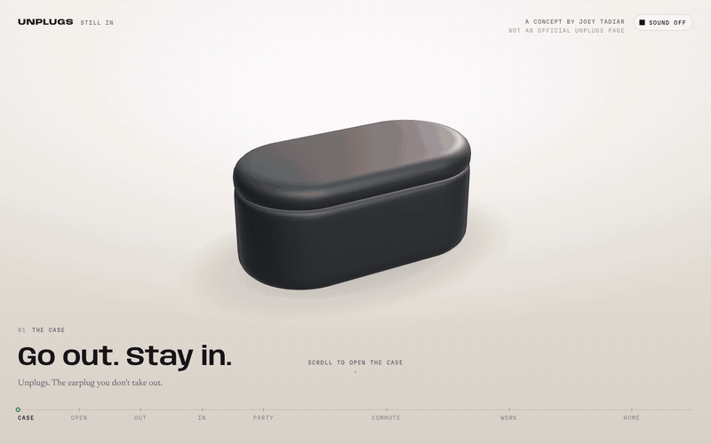

# Unplugs. Still in. A 3D product site

A scroll-driven 3D product site for Unplugs, the earplug you click in and out instead of taking out. It follows one pair through a night out, a commute and a working day.

**Live site:** [joeytadiar.com/unplugs/live](https://joeytadiar.com/unplugs/live/)

An unsolicited concept. Not affiliated with or endorsed by Unplugs.

## Built with

- Blender, for the product model
- three.js, for the 3D scene in the browser
- Plain HTML, CSS and JavaScript, in one file

## How it works

**One file.** The whole site is `index.html`, plus three photos in `img/`. The 3D model and the sound are stored inside the page as text, so it loads without fetching anything else. three.js comes from a public CDN.

**Scroll is the story.** Scrolling does not move the page. It moves through eight chapters: Case, Open, Out, In, Party, Commute, Work and Home. Each chapter sets the camera, the pose of the plugs and the copy. The page blends between them, so the motion stays smooth at any speed, and the loop starts again after Home.

**The click is the idea.** Every time the plugs switch between Out and In, the button moves, a giant word behind them squeezes from a wide OUT to a narrow IN, and the sound drops or opens up.

**Real places behind the product.** From Party onwards a photo fades in behind the plugs: a dance floor, a morning train, an open-plan office. The product always sits in front.

**Sound is optional.** It starts off. Turn it on and each place has its own room sound. When the plugs click in, the page turns the room down by 20 dB and muffles the high end, the way a real earplug would.

**Controls.** Scroll, swipe, the arrow keys, or click a chapter on the rail at the bottom.

## My role

Designed and built by Joey Tadiar. Concept, art direction, copy, interaction and code.

## Run it locally

1. `git clone https://github.com/jtadiar/unplugs-3d.git`
2. `cd unplugs-3d`
3. `python3 -m http.server 8000`
4. Open [http://localhost:8000](http://localhost:8000)

You need an internet connection for three.js and the web fonts.

---

Code © Joey Tadiar. Unplugs and its product design belong to their owners.
